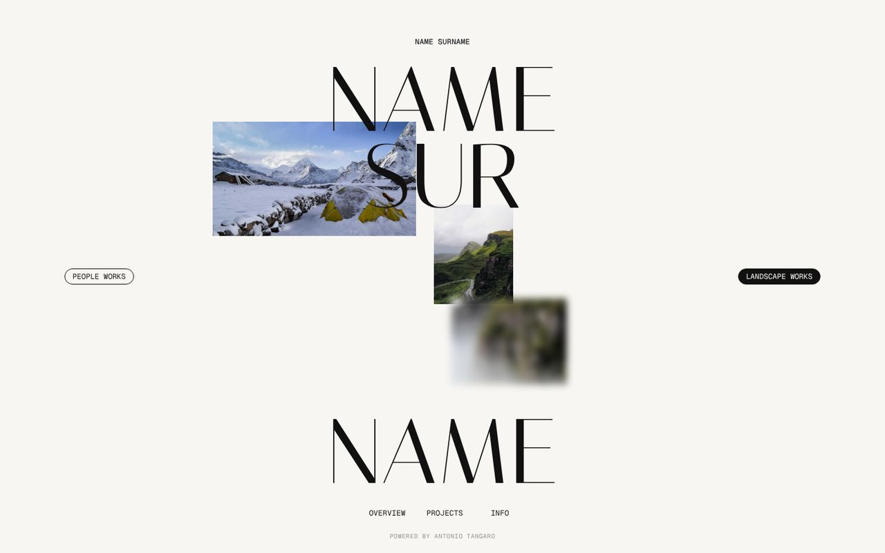
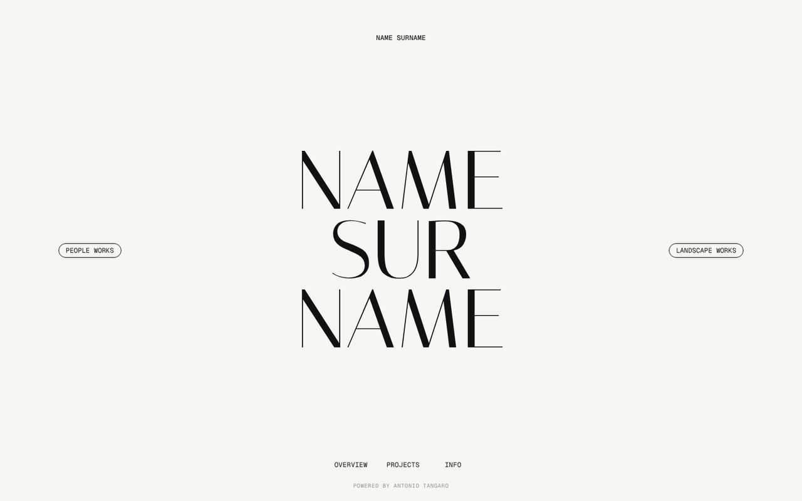
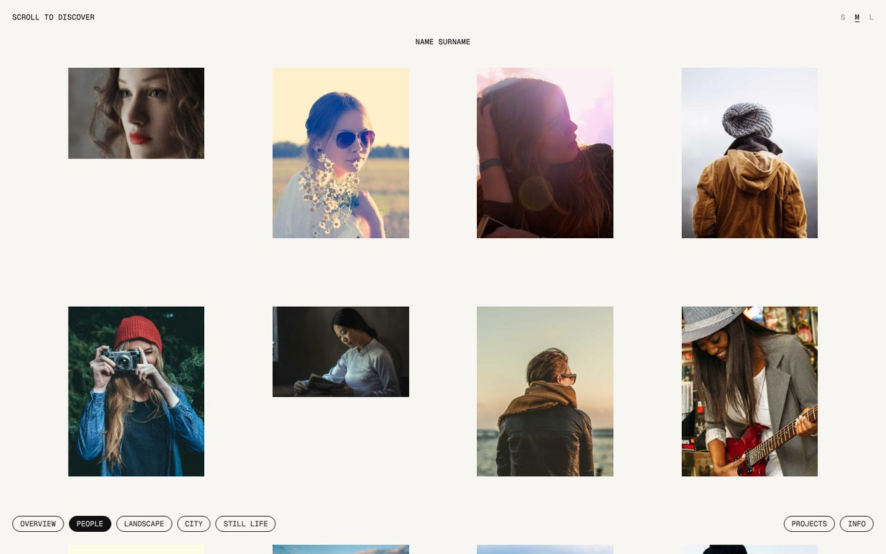
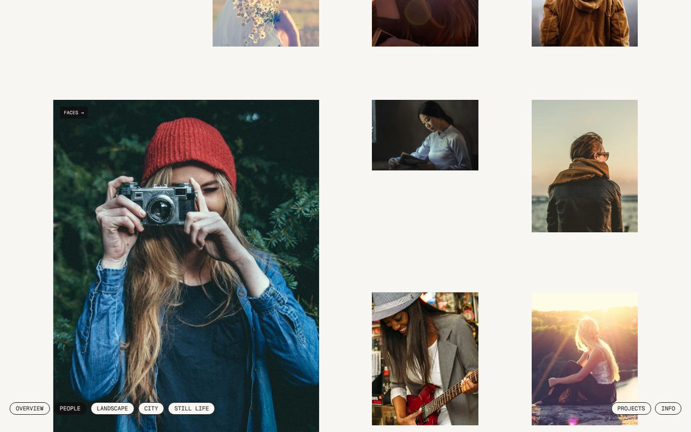
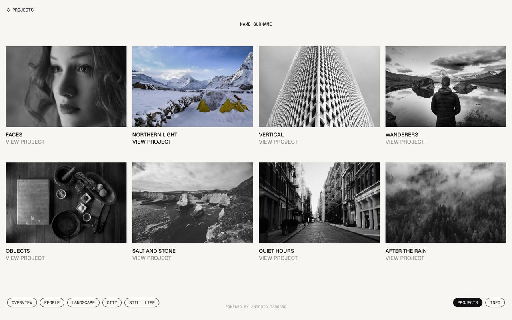
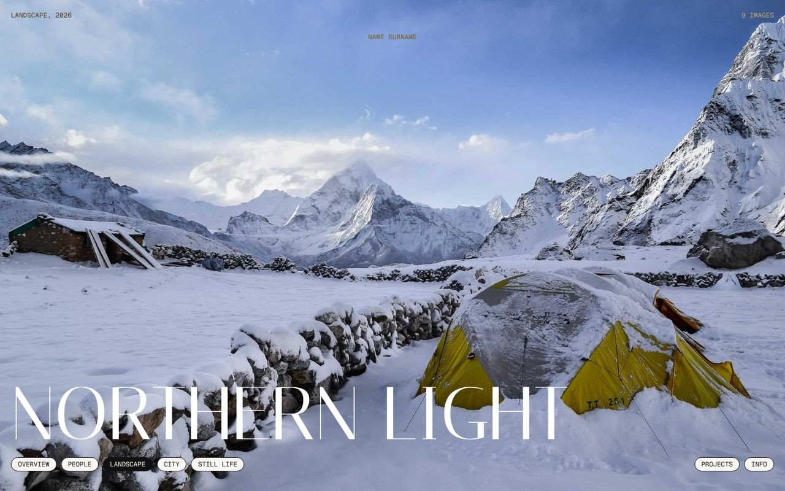
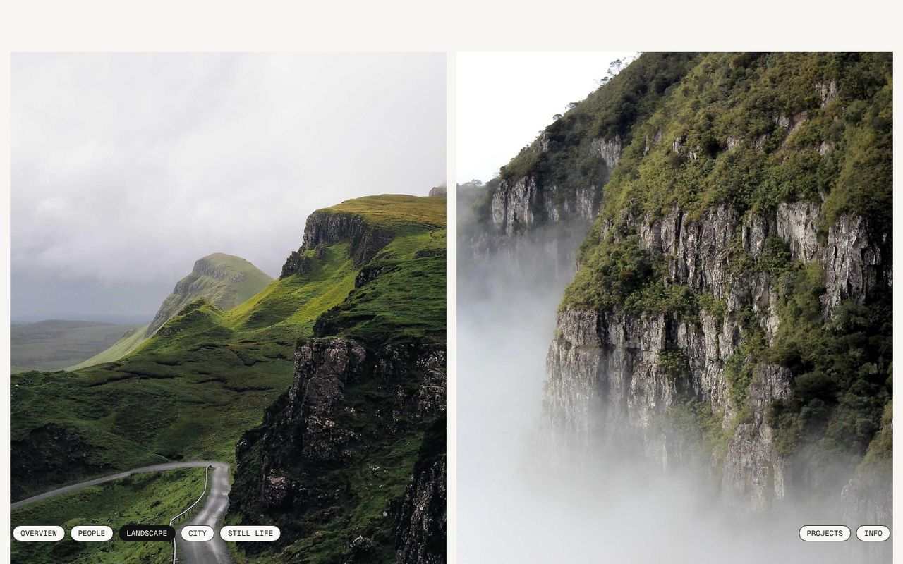
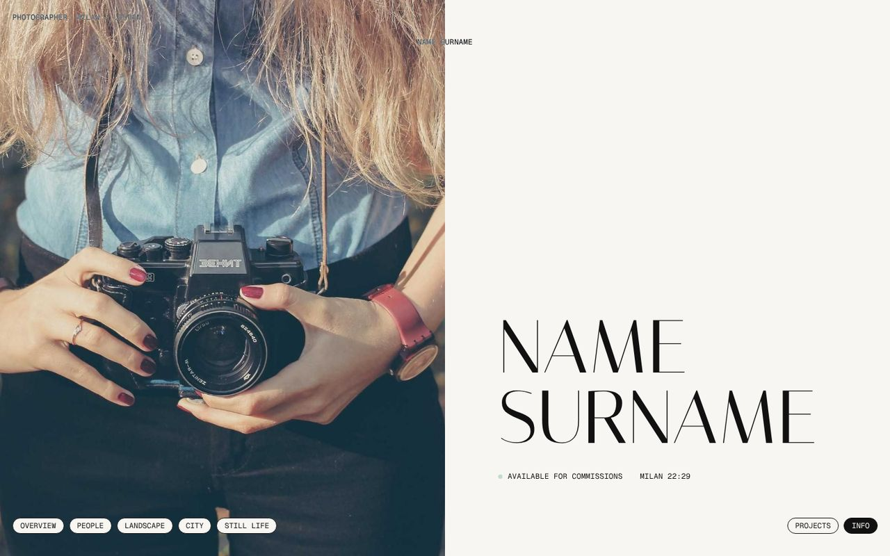
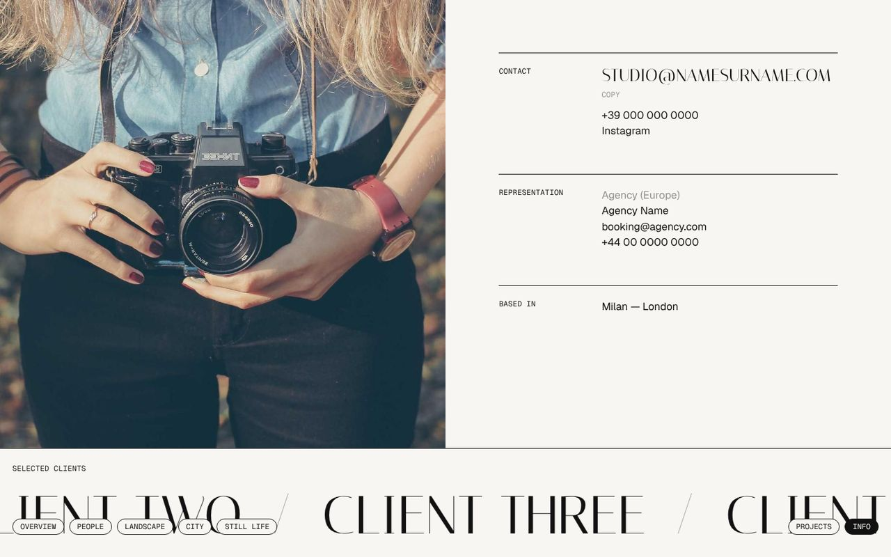
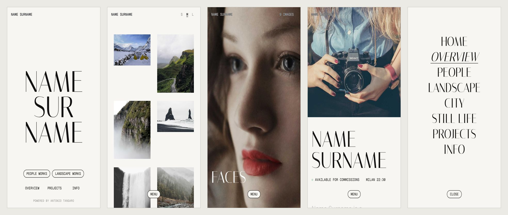

# Photography Portfolio

A minimal, editorial portfolio for photographers. Plain HTML, CSS and JavaScript: nothing to install, no build step, no framework. Edit one file with your texts and drop your photos in a folder.

**[Live demo →](https://antoniooodev.github.io/photography-portfolio/)**



## Screenshots

| | |
|---|---|
|  |  |
| **Home** — the name set large, with category buttons on the sides | **Work** — airy grid of every photo in a category |
|  |  |
| **Work** — a click enlarges a photo in place and links to its project | **Projects** — covers turn from black and white to colour on hover |
|  |  |
| **Project** — full-screen opening photo | **Project** — landscapes full width, portraits in pairs |
|  |  |
| **Info** — sticky portrait, name reveal, live local time | **Info** — contacts, representation and a scrolling client strip |

On phones every page collapses into a single column, with the navigation behind one MENU button:



## Features

- **Five pages**: home, category grids, projects index, project pages and an info page.
- **Everything in one file**: names, texts, categories, projects and contacts live in `js/data.js`.
- **Lightbox** on project pages with keyboard (← → Esc) and swipe support.
- **Grid density switch** (S / M / L) on category pages, remembered between visits.
- **Motion with restraint**: reveals, hover previews and scroll effects, all switched off for visitors who prefer reduced motion.
- **Responsive** from small phones to large screens, including phones held sideways; hover effects are limited to devices with a mouse.
- **No dependencies**: three Google Fonts and nothing else. Works on any static host.

## Getting started

### 1. Download

Clone the repository:

```bash
git clone https://github.com/antoniooodev/photography-portfolio.git
```

```bash
cd photography-portfolio
```

Or download it as a ZIP: on the repository page press **Code → Download ZIP** and unzip it.

### 2. Run it locally

The pages load their content with JavaScript, so open them through a small local server rather than by double-clicking the files. Any of these works.

With Python (already installed on macOS and most Linux systems):

```bash
python3 -m http.server 8000
```

With Node.js:

```bash
npx serve .
```

Then open http://localhost:8000 (or the address printed by `serve`). In VS Code, the **Live Server** extension does the same with one click.

### 3. Make it yours

Open **`js/data.js`** and change:

| Field | What it is |
|---|---|
| `name`, `nameLines` | Your name, and how it is broken across lines on the home page |
| `role`, `location`, `email`, `phone`, `instagram` | Shown in the top bar and on the info page |
| `credit` | The small line at the bottom of every page |
| `categories` | The categories in the bottom navigation (`slug` is used in the URL) |
| `home.left`, `home.right` | The two categories on the home page buttons |
| `info.bio`, `info.availability`, `info.clock` | Bio, availability status, and the city and time zone of the live clock |
| `info.portrait`, `info.clients`, `info.representation` | Portrait, client list and agencies on the info page |
| `projects` | Your projects (see below) |

**Adding a project:**

1. Create a folder `images/<project-slug>/` and put your photos in it, named `01.jpg`, `02.jpg`, … JPGs around 2000px on the long side, at quality 80, are a good balance of sharpness and speed.
2. Add an entry to `projects` in `js/data.js`:

```js
{
  slug: "my-project",              // folder name in images/ and part of the URL
  title: "My Project",
  category: "people",              // one of the category slugs
  client: "Client Name",
  year: 2026,
  description: "One or two sentences about the project.",
  credits: [["Styling", "Name"], ["Model", "Name"]],
  images: [
    { src: "01.jpg", w: 3, h: 2 }, // w and h: proportions of the photo
    { src: "02.jpg", w: 4, h: 5 },
  ],
},
```

The first photo is the cover and the full-screen opening of the project page. `w` and `h` only describe the proportions (`3, 2` for landscape, `4, 5` for portrait, or the real pixel size): landscape photos are shown full width, portraits side by side in pairs.

**Changing the look:** colours, fonts and spacing are CSS custom properties at the top of `css/style.css` (`--ivory`, `--ink`, `--font-display`, `--font-sans`, `--font-mono`, `--airy`, …). The fonts are [Italiana](https://fonts.google.com/specimen/Italiana), [Geist](https://fonts.google.com/specimen/Geist) and [Geist Mono](https://fonts.google.com/specimen/Geist+Mono), loaded from Google Fonts in each HTML file.

### 4. Publish

**GitHub Pages** (free):

1. Push the project to a GitHub repository.
2. Go to **Settings → Pages**, set *Source* to **Deploy from a branch**, choose `main` and `/ (root)`, then **Save**.
3. After a minute or two the site is live at `https://<username>.github.io/<repository>/`, and every push updates it.

**Netlify or Vercel**: import the repository, leave the build command and output directory empty, and deploy.

## Project structure

```
photography-portfolio/
├── index.html            Home
├── work.html             Category grids (work.html?c=<category>), all photos without ?c=
├── projects.html         Projects index
├── project.html          Single project (project.html?p=<project-slug>)
├── info.html             Bio, contacts, representation and clients
├── css/
│   └── style.css         All styles; design tokens at the top
├── js/
│   ├── data.js           All content: edit this file
│   └── main.js           Renders the pages and handles the interactions
├── images/
│   ├── <project-slug>/   One folder per project: 01.jpg, 02.jpg, …
│   └── info/
│       └── portrait.jpg  Portrait on the info page
├── docs/
│   └── screenshots/      Images used in this README
├── CREDITS.md            Authors of the demo photos
├── LICENSE
└── README.md
```

## Demo photos

The photos in `images/` are demo images from [Unsplash](https://unsplash.com), used under the [Unsplash License](https://unsplash.com/license) and credited to their authors in [`CREDITS.md`](CREDITS.md). They are only there to show the site complete: replace them with your own work before publishing. The categories, project titles and texts are placeholders too.

## License

Released under the [MIT License](LICENSE). Copyright © 2026 Antonio Tangaro — [antoniotangaro.dev](https://www.antoniotangaro.dev/).

You are free to use, modify and publish this portfolio, including for commercial work, as long as the copyright notice in `LICENSE` is kept. Keeping the "Powered by" line at the bottom of the pages is appreciated but not required.

The license covers the code and documentation only. The demo photos belong to their authors and are used under the Unsplash License; the fonts are distributed by Google Fonts under the SIL Open Font License.
